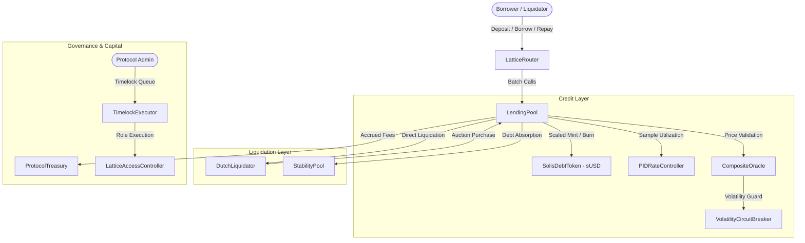
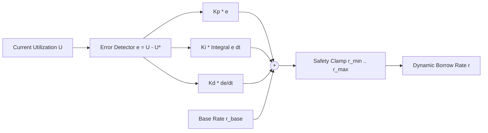
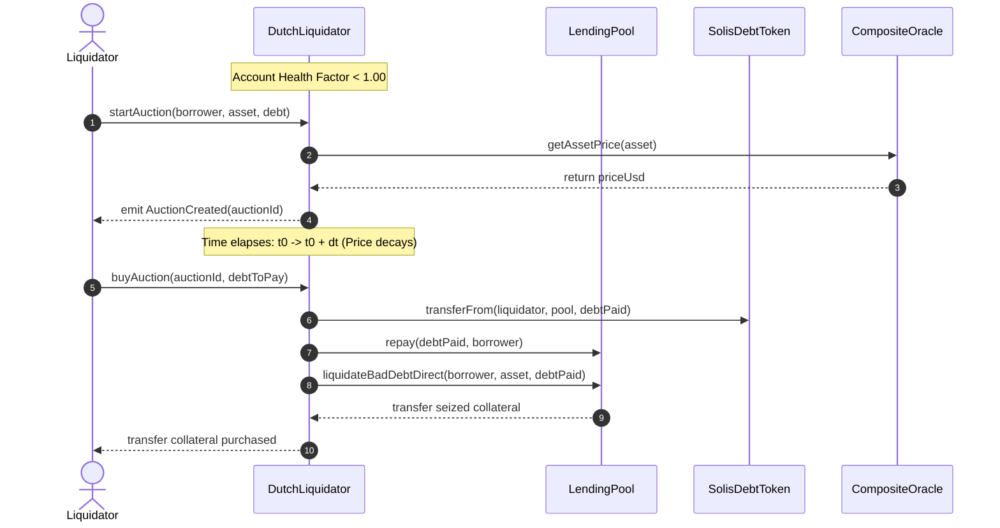

# SolisLattice

[](https://github.com/ZengLLQ/solis-lattice/actions/workflows/ci.yml)
[](LICENSE)
[](https://soliditylang.org/)
[](https://eips.ethereum.org/)

An autonomous multi-asset collateralized debt facility featuring continuous Proportional-Integral-Derivative (PID) interest rate regulation, $O(1)$ constant-time stability pool debt absorption, linear Dutch auction liquidation waterfalls, and EIP-1153 transient-storage flash accounting.

---

## 1. System Architecture

SolisLattice replaces static, piecewise linear kink curves with an active control-theoretic interest rate regulator. The system coordinates five specialized layers:

1. **Mathematical Primitives**: High-precision 18-decimal (WAD) and 27-decimal (RAY) arithmetic, 6th-order Taylor series continuous compounding, Newton-Raphson/Halley polynomial root solvers, and 256-bit packed bitmap and Fenwick cumulative sum index structures.
2. **Core Credit Engine**: Multi-collateral lending pool, scaled debt tracking (`sUSD`), and transient-storage zero-debt delta balance verification.
3. **Liquidation & Absorption Mechanics**: Dual-tier liquidation system combining a constant-time $O(1)$ product-accumulator stability pool with an interactive continuous Dutch auction.
4. **Oracle & Volatility Circuit Breakers**: Institutional composite oracle with decimal normalization, multi-feed deviation cross-checks, heartbeat validation, and rate-of-change volatility guards.
5. **Governance & Periphery**: Multi-role access controller, delayed timelock execution queue, fee-splitting protocol treasury, and atomic multicall periphery router.



---

## 2. Mathematical Foundations

### 2.1 Fixed-Point Representation
All computations use strict integer arithmetic with explicit rounding modes:
- **WAD**: 18 decimal places ($10^{18}$), used for token quantities, collateral amounts, LTV ratios, and health factors.
- **RAY**: 27 decimal places ($10^{27}$), used for borrow indices, cumulative compounding factors, and price multipliers.

$$\text{WAD} = 10^{18}, \quad \text{RAY} = 10^{27}, \quad \text{WAD\_TO\_RAY\_RATIO} = 10^9$$

### 2.2 Continuous Compounding via 6th-Order Taylor Series
Instead of coarse block-by-block compounding or iterative approximations, the protocol calculates the continuous interest multiplier $C(t) = \exp(r \cdot \Delta t)$ using a truncated Taylor series polynomial evaluated in RAY fixed-point:

$$x = \frac{r_{\text{annual}} \cdot \Delta t}{T_{\text{year}}}, \quad \text{where } T_{\text{year}} = 31{,}536{,}000 \text{ s}$$

$$\exp(x) \approx 1 + x + \frac{x^2}{2!} + \frac{x^3}{3!} + \frac{x^4}{4!} + \frac{x^5}{5!} + \frac{x^6}{6!}$$

Analytical truncation error satisfies:

$$R_6(x) \le \frac{x^7}{7!} \cdot e^x < 10^{-14} \quad \text{for } x \le 0.10$$

### 2.3 Closed-Loop PID Interest Rate Model
Traditional lending markets employ static utilization curves that cannot dynamically adapt to systemic capital inflows or persistent debt demand. SolisLattice calculates interest rate updates via a discrete PID control law:

$$e(t) = U(t) - U^*$$

$$I(t) = \text{clamp}\left(I(t-1) + e(t) \cdot \Delta t, -I_{\max}, I_{\max}\right)$$

$$D(t) = \frac{e(t) - e(t-1)}{\max(\Delta t, 1)}$$

$$r(t) = \text{clamp}\left(r_{\text{base}} + K_p \cdot e(t) + K_i \cdot I(t) + K_d \cdot D(t), r_{\min}, r_{\max}\right)$$

where:
- $U(t) = \frac{D_{\text{borrows}}}{D_{\text{borrows}} + R_{\text{reserves}}}$ is current capital utilization.
- $U^*$ is the protocol target equilibrium utilization (default: $80\%$).
- $K_p, K_i, K_d$ are proportional, integral, and derivative gains.
- Anti-windup clamping prevents persistent error accumulation during market stress.



### 2.4 $O(1)$ Stability Pool Product-Sum Accumulators
The stability pool enables instant bad debt socialization without iterating across depositor accounts. Two global accumulators are maintained:

1. **Deposit Product Accumulator ($P$)**: Tracks remaining fraction of original principal:
   $$P_k = P_{k-1} \cdot \left(1 - \frac{D_{\text{loss}}}{D_{\text{pool}}}\right)$$
2. **Collateral Gain Sum Accumulator ($S$)**: Tracks seized collateral rewards allocated per unit of initial deposit:
   $$S_k = S_{k-1} + \frac{C_{\text{gain}}}{D_{\text{pool}} \cdot P_{k-1}}$$

When user $i$ deposited at snapshot $(P_0, S_0, \text{epoch}_0)$, their current compounded deposit balance is:

$$D_i = D_{0,i} \cdot \frac{P_{\text{current}}}{P_0}$$

and their claimable collateral gain is:

$$C_i = D_{0,i} \cdot \frac{S_{\text{current}} - S_0}{10^{18}}$$

When a liquidation occurs where $D_{\text{loss}} \ge D_{\text{pool}}$, the active epoch increments ($\text{epoch} \leftarrow \text{epoch} + 1$), product resets to $10^{18}$, and deposits prior to that epoch evaluate to zero.

### 2.5 Dutch Liquidation Waterfall
Underwater accounts ($HF < 1.0$) are eligible for continuous Dutch auction settlement:

$$P_{\text{auction}}(t) = P_{\text{start}} - \left(\frac{t - t_0}{T_{\text{duration}}}\right) \cdot (P_{\text{start}} - P_{\text{floor}})$$

where $P_{\text{start}} = P_{\text{oracle}} \cdot (1 + \beta_{\text{premium}})$ and $P_{\text{floor}} = P_{\text{oracle}} \cdot (1 - \gamma_{\text{discount}})$.



---

## 3. Subsystem Breakdown

| Subsystem | Contract | Key Responsibilities |
| :--- | :--- | :--- |
| **Libraries** | `WadRayMath.sol` | 18/27-dec math, safe up/down rounding, ray power |
| | `ExpCompoundMath.sol` | 6th-order Taylor series continuous compounding |
| | `PIDMath.sol` | Control-theoretic PID update with anti-windup clamping |
| | `RootSolvers.sol` | Newton-Raphson & Halley cubic root solvers |
| | `BitmapTree.sol` | 256-bit packed bitmap index and LSB/MSB scanning |
| | `FenwickTree.sol` | Binary Indexed Tree for $O(\log N)$ cumulative risk queries |
| | `TransientSlot.sol` | EIP-1153 Cancun `tstore`/`tload` reentrancy and net debt assertions |
| **Tokens** | `SolisDebtToken.sol` | Scaled debt token (`sUSD`) with transferrable nominal balances |
| | `SolisCollateralToken.sol` | Standard institutional ERC20 collateral token |
| **Core** | `LendingPool.sol` | Collateral deposits, borrows, health factors, interest indexing |
| | `PIDRateController.sol` | Dynamic interest rate adjustments driven by utilization shocks |
| | `StabilityPool.sol` | $O(1)$ constant-time debt absorption with product-sum accumulators |
| | `DutchLiquidator.sol` | Linear decaying Dutch auction liquidation clearing |
| | `FlashEngine.sol` | EIP-1153 transient flash minting and balance invariance enforcement |
| **Oracle** | `CompositeOracle.sol` | Multi-feed price normalization and confidence scoring |
| | `VolatilityCircuitBreaker.sol`| Rate-of-change price shock detection and automatic circuit tripping |
| | `MockPriceFeed.sol` | Programmable testing feed |
| **Governance** | `LatticeAccessController.sol`| Role-based access control (`ADMIN`, `TIMELOCK`, `GUARDIAN`) |
| | `TimelockExecutor.sol` | 2-step timelock with cancellation and grace windows |
| | `ProtocolTreasury.sol` | Protocol reserve fund and insurance buffer fee splitting |
| **Periphery** | `LatticeRouter.sol` | Atomic multicall deposit-and-borrow and repay-and-withdraw |
| | `FlashLiquidator.sol` | Reference flash-arbitrage liquidation receiver |

---

## 4. Verification and Testing

### 4.1 Test Matrix
The test suite consists of **16 test suites comprising 48 unit, lifecycle, and invariant tests** executed via Foundry:

- **Stateful Fuzz Invariants**:
  - `testFuzz_InvariantTotalDebtAccounting`: Asserts global debt equals $\sum \text{scaledDebt}_i \cdot \text{borrowIndex} / \text{RAY}$ across 256 random borrow steps.
  - `testFuzz_InvariantSolvency`: Asserts $HF \ge 1.0$ for all solvent deposit-borrow permutations under fuzzing.
  - `test_InvariantStabilityPoolProductBound`: Asserts $P \le 1.0 \times 10^{18}$ throughout repeated debt absorption cycles.
  - `test_TransientFlashAccounting_Settled`: Asserts net debt delta strictly equals 0 in transient storage at scope conclusion.

### 4.2 Running Tests Locally
```bash
# Compile contracts
forge build --sizes

# Run full test suite with 256 fuzz runs
forge test -vvv --fuzz-runs 256

# Check formatting compliance
forge fmt --check

# Execute multi-actor market stress simulation with ASCII visualizer
forge script script/SimulateMarketStress.s.sol
```

---

## 5. Pure 7-bit ASCII Visualizer

The project includes an in-terminal 7-bit ASCII status visualizer (using characters $0$ through $127$ strictly to prevent Windows CP1252 or headless CI encoding errors):

```text
+-----------------------------------------------------------------+
|                     SOLIS LATTICE PROTOCOL                      |
|            Pure 7-bit ASCII Protocol Stress Visualizer          |
+-----------------------------------------------------------------+

 [1] BORROWER HEALTH FACTOR GAUGE (Threshold = 1.00x)
 -------------------------------------------------------------
 Status: [WARNING]  | HF: 1.00x - 1.50x
 [====================#........................] Near Liquidation
 -------------------------------------------------------------

 [2] PID DYNAMIC INTEREST RATE RESPONSE (r vs U)
 -------------------------------------------------------------
 APR (%)
  50% |                                              *
  40% |                                         *    *
  30% |                                    *    *
  20% |                              *     *
  10% |                        *     *
   4% | *    *    *     *      *     (Target U* = 80%)
   0% +------------------------+-----+-----+-----+-----+------
       0%   20%  40%   60%    80%   85%   90%   95%   100% Util
 -------------------------------------------------------------
 Current Equilibrium Borrow Rate: 4.00% APR (WAD: 40000000000000000)

 [3] DUTCH LIQUIDATION EXPONENTIAL PRICE DECAY WATERFALL
 -------------------------------------------------------------
 Price ($)
 $3,150 | \ Start Price (+5% Premium at t=0)
 $3,000 |  \
 $2,850 |   \
 $2,700 |    \
 $2,550 |     \___ Floor Price (-15% Discount at t=1800s)
        +----------------------------------------------------> t (sec)
         t=0s       t=450s      t=900s      t=1350s     t=1800s
 -------------------------------------------------------------
```

---

## 6. Threat Model and Known Limitations

### 6.1 Threat Model Assumptions
- **Cancun EVM Compatibility**: The protocol relies upon `tstore` (0x5c) and `tload` (0x5d) opcodes specified in EIP-1153. Deployment on chains without Cancun support will revert.
- **Oracle Staleness**: If an oracle heartbeat expires without a fresh update, borrowing operations on that collateral are paused until refreshed.
- **Circuit Breaker Triggering**: When volatility exceeds $15\%$ within an hour, the breaker trips to prevent front-running oracle updates, requiring administrative reset.

### 6.2 Known Limitations
- **Discrete Compounding Granularity**: While Taylor expansion is analytically continuous, interest index updates occur on state-changing transactions. High-frequency updates minimize discretization gap.
- **Zero-Sum Stability Pool Depletion**: In extreme cascading market drawdowns where total bad debt exceeds total stability pool deposits, the active epoch flips and remaining bad debt requires secondary waterfall auction absorption.

---

## 7. License

MIT License. Copyright (c) 2026 ZengLLQ.
